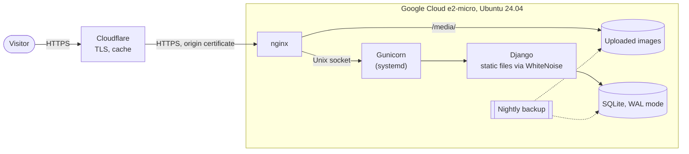
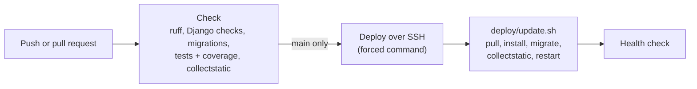

# nestorbracho.com

[](https://github.com/NestorBracho/blogweb/actions/workflows/deploy.yml)


[](https://github.com/astral-sh/ruff)
[](LICENSE)

My personal website and bilingual (English/Spanish) blog, live at **[nestorbracho.com](https://nestorbracho.com)**.

It is also a small but complete example of how I build and run web applications: a Django backend with a
REST API, tests and linting in CI, and a hardened self-hosted deployment that costs nothing to run.


## Where to look

| To see...                              | Look at                                                                                              |
|----------------------------------------|------------------------------------------------------------------------------------------------------|
| Models, views, i18n                    | [`blog/`](blog), [`main/`](main), [`config/`](config)                                                 |
| A REST API with Django REST Framework  | [`blog/api/`](blog/api): separate read/write serializers, staff-only writes                          |
| An LLM integration                     | [`blog/drafting.py`](blog/drafting.py): OpenAI structured outputs validated with Pydantic            |
| Tests                                  | `*/tests.py`: views, API permissions, feeds, forms, open-redirect protection                         |
| CI/CD                                  | [`.github/workflows/deploy.yml`](.github/workflows/deploy.yml)                                       |
| Server configuration                   | [`deploy/`](deploy): nginx, a hardened systemd unit, backup and update scripts                       |
| Why it is built this way               | [`docs/adr/`](docs/adr): architecture decision records                                               |

## Features

- Posts written in Markdown in both languages, with syntax highlighting, tables, admonitions and a copy button on
  code blocks.
- English/Spanish switcher built on Django's i18n; interface strings are translated with gettext.
- "Load more" pagination and live search served by the JSON API.
- RSS feed, XML sitemap, `robots.txt` and Open Graph / Twitter Card metadata.
- A contact form that stores every request before emailing it, so a mail outage never loses a message.
- Newsletter sign-up that only ever redirects back to this site.
- Light and dark themes.
- An optional command that drafts posts with OpenAI for me to review (see [AI-assisted drafts](#ai-assisted-drafts)).

## Architecture



- **Cloudflare** terminates TLS for visitors, caches static files and images, and reaches the origin over HTTPS
  with a Cloudflare origin certificate.
- **nginx** serves uploaded images straight from disk and proxies everything else to Gunicorn over a Unix socket.
- **Django** serves its own static files with WhiteNoise (compressed, with cache-busting file names).
- **SQLite** in WAL mode holds all the data. A nightly job backs up the database and the images, and copies them
  off the server with rclone when a remote is configured.

### CI/CD



Every push and pull request runs the checks; the coverage report is published in each run's summary. Pushes to
`main` are then deployed by GitHub Actions with an SSH key that the server only allows to run
[`deploy/update.sh`](deploy/update.sh), and the job fails unless the site answers `200` afterwards.

## Design decisions

1. [SQLite in production](docs/adr/0001-sqlite-in-production.md)
2. [A single free-tier VM instead of a PaaS](docs/adr/0002-single-free-tier-vm.md)
3. [Cloudflare in front of the origin](docs/adr/0003-cloudflare-in-front-of-the-origin.md)
4. [Deploying from CI with a forced-command SSH key](docs/adr/0004-deploy-with-a-forced-command-ssh-key.md)

## Tech stack

- **Backend:** Python 3.12, Django 5.2, Django REST Framework, Markdown and Pygments
- **Frontend:** Django templates, jQuery and Splide, on top of the Coderon theme (see [Credits](#credits))
- **Infrastructure:** Google Cloud, Ubuntu 24.04, nginx, Gunicorn, systemd, Cloudflare, SQLite
- **Tooling:** GitHub Actions, ruff, coverage, pre-commit

## Project structure

```
config/        settings, root URLs, base model, context processors
blog/          posts and categories: views, REST API, RSS feed, sitemaps, drafting command
main/          home, about and contact pages, template tags
usermanager/   newsletter subscribers
templates/     base layout and shared partials
static/        theme assets and images
locale/        Spanish translations
deploy/        nginx, systemd, backup and update scripts, server guide (in Spanish)
docs/adr/      architecture decision records
```

## Running locally

Requires Python 3.12.

```bash
python3 -m venv venv
source venv/bin/activate
pip install -r requirements-dev.txt
pre-commit install  # optional: run ruff before every commit
```

Create a `.env` file for development. Every other setting has a default that works locally;
[`.env.example`](.env.example) documents the production ones.

```dotenv
SECRET_KEY=dev-only-not-secret
DEBUG=True
EMAIL_BACKEND=django.core.mail.backends.console.EmailBackend
```

```bash
python manage.py migrate
python manage.py createsuperuser
python manage.py runserver
```

Posts are written in the admin at `/admin/` (the path is configurable with `ADMIN_URL`).

## Checks

The same checks run in CI:

```bash
ruff check .
ruff format --check .
coverage run manage.py test && coverage report
```

Tests expect `DEBUG=True`, as in CI: with `DEBUG=False` the production settings redirect every request to HTTPS.

## AI-assisted drafts

```bash
python manage.py draft_article "Ownership in Rust" --category programming [--no-cover]
```

The command asks OpenAI for an article in both languages as structured output (a Pydantic model the SDK turns into
a strict JSON schema), saves it as an **unpublished draft** and, unless `--no-cover` is passed, generates a cover
image. Nothing is published automatically: drafts are meant to be reviewed and edited in the admin. It needs
`OPENAI_API_KEY`; the model can be changed with `OPENAI_MODEL`. The tests use a fake client, so they never call the
API.

## API

| Method                         | Endpoint                 | Description                                                    |
|--------------------------------|--------------------------|----------------------------------------------------------------|
| `GET`                          | `/api/post/?page=N`      | Published posts, newest first, four per page                   |
| `GET`                          | `/api/post/?search=term` | Posts whose title, description, body or category match         |
| `GET`                          | `/api/categories`        | The four most recently active categories and their latest posts |
| `POST`, `PUT`, `PATCH`, `DELETE` | `/api/post/…`          | Staff only                                                     |

The `X-Language` header (`en` or `es`) selects the language of the returned fields.

## Deployment

Production runs on a single Google Cloud e2-micro VM behind Cloudflare. The step-by-step server guide, including
the CI/CD setup, is in [`deploy/README.md`](deploy/README.md) (in Spanish).

## Credits

The visual design (the page markup, [`static/css/main.css`](static/css/main.css) and
[`static/js/common.js`](static/js/common.js)) comes from the Coderon Jekyll theme by
[Artem Sheludko](https://jekyllthemes.io/developers/artem-sheludko), ported here to Django templates. Those files
are subject to the theme's own license.

## License

The code is released under the [MIT License](LICENSE), except for the theme assets listed under
[Credits](#credits).
