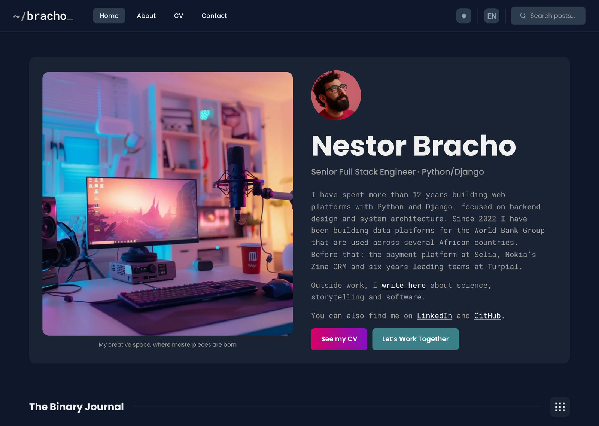
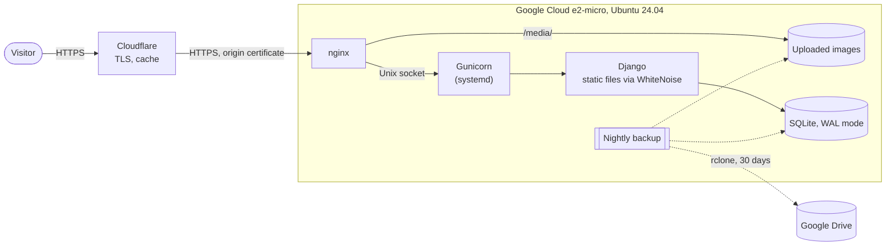
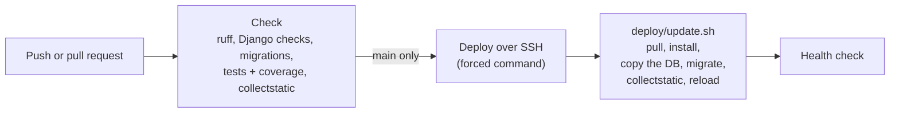

# nestorbracho.com

[](https://github.com/NestorBracho/blogweb/actions/workflows/deploy.yml)


[](https://github.com/astral-sh/ruff)
[](LICENSE)

My personal website and bilingual (English/Spanish) blog, live at **[nestorbracho.com](https://nestorbracho.com)**.

It is also a small but complete example of how I build and run web applications: a Django backend with a
REST API, tests and linting in CI, and a hardened self-hosted deployment that costs nothing to run.



## Where to look

| To see...                              | Look at                                                                                              |
|----------------------------------------|------------------------------------------------------------------------------------------------------|
| Models, views, i18n                    | [`blog/`](blog), [`main/`](main), [`config/`](config)                                                 |
| A REST API with Django REST Framework  | [`blog/api/`](blog/api): separate read/write serializers, staff-only writes                          |
| An LLM integration                     | [`blog/drafting.py`](blog/drafting.py): OpenAI structured outputs validated with Pydantic            |
| Tests                                  | `*/tests.py`: views, API permissions, feeds, forms, open-redirect protection                         |
| CI/CD                                  | [`.github/workflows/deploy.yml`](.github/workflows/deploy.yml)                                       |
| Server configuration                   | [`deploy/`](deploy): nginx, a hardened systemd unit, backup and update scripts                       |
| Why it is built this way               | [`docs/adr/`](docs/adr): architecture decision records                                               |
| What is mine, the theme's or AI-assisted | [How this was built](#how-this-was-built)                                                          |

## Features

- Posts written in Markdown in both languages, with syntax highlighting, tables, admonitions and a copy button on
  code blocks. The rendered HTML is sanitized with nh3, so nothing in a post can run a script.
- Covers made at the size each part of the site shows them (WebP, and a JPEG for link previews) whenever a post's
  cover changes: the post page, cards and thumbnails each load only the pixels they need.
- Every page in English and Spanish at its own address (`/en/…`, `/es/…`), so both can be indexed and shared; the
  bare domain sends each visitor to their language, and English to crawlers and everyone else
  ([ADR 6](docs/adr/0006-language-in-the-url.md)). Interface strings are translated with gettext.
- "Load more" pagination and live search served by the JSON API.
- An RSS feed per language, an XML sitemap that links each page to its other language, and `robots.txt`.
- In every page's `<head>`: a canonical URL without tracking parameters, `hreflang` links to the page in each
  language, Open Graph / Twitter Card metadata, and schema.org data (JSON-LD) for the person behind the site and
  for each post.
- A contact form that stores every request before emailing it, so a mail outage never loses a message.
- Newsletter sign-up with double opt-in: a signed, expiring link confirms each address, and the form never reveals
  who is already subscribed.
- A honeypot field on both forms against spam bots, and a privacy policy in both languages.
- A Content-Security-Policy that only lets the site's own scripts run (none inline), on top of HSTS and Django's
  other security headers.
- Light and dark themes.
- An optional command that drafts posts with OpenAI for me to review (see [AI-assisted drafts](#ai-assisted-drafts)).

## Architecture



- **Cloudflare** terminates TLS for visitors, caches static files and images, and reaches the origin over HTTPS
  with a Cloudflare origin certificate. The VM's firewall only accepts web traffic from Cloudflare's IP ranges.
- **nginx** serves uploaded images straight from disk and proxies everything else to Gunicorn over a Unix socket.
- **Django** serves its own static files with WhiteNoise (compressed, with cache-busting file names).
- **SQLite** in WAL mode holds all the data. A nightly job backs up the database and the images, keeps two weeks
  of them on the server and copies them to Google Drive with rclone, where it keeps 30 days.

### CI/CD



Every push and pull request runs the checks; the coverage report is published in each run's summary. Pushes to
`main` are then deployed by GitHub Actions with an SSH key that the server only allows to run
[`deploy/update.sh`](deploy/update.sh), and the job fails unless `/en/` answers `200` and the bare domain redirects
there afterwards. Deploys copy the database before running migrations. Gunicorn reloads gracefully, so a deploy doesn't drop requests.

## Design decisions

1. [SQLite in production](docs/adr/0001-sqlite-in-production.md)
2. [A single free-tier VM instead of a PaaS](docs/adr/0002-single-free-tier-vm.md)
3. [Cloudflare in front of the origin](docs/adr/0003-cloudflare-in-front-of-the-origin.md)
4. [Deploying from CI with a forced-command SSH key](docs/adr/0004-deploy-with-a-forced-command-ssh-key.md)
5. [Off-site backups to Google Drive](docs/adr/0005-off-site-backups-to-google-drive.md)
6. [The language in the URL](docs/adr/0006-language-in-the-url.md)

## Tech stack

- **Backend:** Python 3.12, Django 5.2, Django REST Framework, Markdown, Pygments and nh3
- **Frontend:** Django templates, jQuery and Splide, on top of the Coderon theme (see [Credits](#credits))
- **Infrastructure:** Google Cloud, Ubuntu 24.04, nginx, Gunicorn, systemd, Cloudflare, SQLite
- **Tooling:** GitHub Actions, ruff, coverage, pre-commit, pip-tools, pip-audit, Dependabot

## Project structure

```
config/        settings, root URLs, base model, context processors
blog/          posts and categories: views, REST API, RSS feed, sitemaps, drafting command
main/          home, about and contact pages, template tags
usermanager/   newsletter subscribers
templates/     base layout and shared partials
static/        theme assets and images
locale/        Spanish translations
deploy/        nginx, systemd, backup and update scripts, server guide (in Spanish)
docs/adr/      architecture decision records
brand/         brand kit: logo, favicons, share image and their generator
```

## Running locally

Requires Python 3.12.

```bash
python3 -m venv venv
source venv/bin/activate
pip install -r requirements-dev.txt
pre-commit install  # optional: run ruff before every commit
```

Create a `.env` file for development. Every other setting has a default that works locally;
[`.env.example`](.env.example) documents the production ones.

```dotenv
SECRET_KEY=dev-only-not-secret
DEBUG=True
EMAIL_BACKEND=django.core.mail.backends.console.EmailBackend
```

```bash
python manage.py migrate
python manage.py createsuperuser
python manage.py runserver
```

Posts are written in the admin at `/admin/` (the path is configurable with `ADMIN_URL`).

## Checks

The same checks run in CI:

```bash
ruff check .
ruff format --check .
coverage run manage.py test && coverage report
```

Tests expect `DEBUG=True`, as in CI: with `DEBUG=False` the production settings redirect every request to HTTPS.

## Dependencies

[`requirements.in`](requirements.in) lists what the site uses directly, and
[`requirements-dev.in`](requirements-dev.in) adds the development tools. [pip-tools](https://pip-tools.readthedocs.io/)
compiles them into the pinned `requirements.txt` (installed on the server) and `requirements-dev.txt` (installed in
CI and locally), with a note on why each package is there:

```bash
pip-compile --strip-extras requirements.in
pip-compile --strip-extras requirements-dev.in
pip-compile --strip-extras --upgrade-package django requirements.in  # update one package
```

CI fails if a `.in` file changed without recompiling and audits every pin with `pip-audit`. Dependabot proposes
updates every week and recompiles both files itself.

## AI-assisted drafts

```bash
python manage.py draft_article "Ownership in Rust" --category programming [--no-cover]
```

The command asks OpenAI for an article in both languages as structured output (a Pydantic model the SDK turns into
a strict JSON schema), saves it as an **unpublished draft** and, unless `--no-cover` is passed, generates a cover
image. Nothing is published automatically: drafts are meant to be reviewed and edited in the admin. It needs
`OPENAI_API_KEY`; the model can be changed with `OPENAI_MODEL`. The tests use a fake client, so they never call the
API.

## API

| Method                           | Endpoint                 | Description                                                         |
|----------------------------------|--------------------------|---------------------------------------------------------------------|
| `GET`                            | `/api/post/?page=N`      | Published posts, newest first, four per page                        |
| `GET`                            | `/api/post/?search=words`| Posts with every word somewhere in their title, description, body or category |
| `GET`                            | `/api/categories`        | The four most recently active categories and their latest posts     |
| `POST`                           | `/api/post/`             | Staff only: create a post, a draft unless `is_published` is sent    |
| `GET`, `PUT`, `PATCH`, `DELETE`  | `/api/post/<id>/`        | Anyone can read a published post; staff can also read, edit, publish or delete drafts |

Post lists are paginated; `page_size` raises the page size up to 20. They only ever show published posts, also to
staff, because the home page reads them. Writes return the post's `id` and its `slug`, made from the English title.
The API has no language in its URL. Pages send an `X-Language` header (`en` or `es`) with their own language;
without it, responses follow the language cookie or `Accept-Language`, and English otherwise. Links in the
responses point to the pages in that language.

## Deployment

Production runs on a single Google Cloud e2-micro VM behind Cloudflare. The step-by-step server guide, including
the CI/CD setup, is in [`deploy/README.md`](deploy/README.md) (in Spanish).

## Brand

The "~/bracho_" identity (wordmark, "nb_" monogram, favicons and the default share image) is described in
[`brand/BRAND.md`](brand/BRAND.md), next to the script that generates it. The site renders the wordmark as live
text ([`templates/lib/_brand_wordmark.html`](templates/lib/_brand_wordmark.html), styled in
[`static/css/brand.css`](static/css/brand.css)), so it follows the light and dark themes.

## How this was built

So that anyone reviewing this repository knows what to judge me on:

- **Design.** The visual design is the Coderon Jekyll theme (see [Credits](#credits)). I ported its markup to Django
  templates and left its stylesheet and scripts as they were. The styles I added live in their own files
  ([`static/css/brand.css`](static/css/brand.css) and `main/static/main/*/styles.css`).
- **June 2025 to September 2026: the project itself.** The apps and models, the bilingual content, the REST API, the
  contact and newsletter forms, and the first version of the article generator.
- **Since September 2026: AI-first.** I use Claude Code as a pair programmer. It worked with me on the CI/CD
  pipeline and the deployment guide, the fixes from a code review, the tests, the architecture decision records and
  this README, and most of those commits say so in a `Co-Authored-By: Claude` trailer. Since October 2026 every
  change goes through a pull request that has to pass CI, and I review and merge each one myself. The brand kit in
  [`brand/`](brand) was made with Claude Design.
- **Posts.** The two posts still published from June 2025 were drafted by the first version of the article
  generator. [`draft_article`](blog/management/commands/draft_article.py) now only saves drafts, for me to rewrite
  before publishing.

## Credits

The visual design (the page markup, [`static/css/main.css`](static/css/main.css) and
[`static/js/common.js`](static/js/common.js)) comes from the Coderon Jekyll theme by
[Artem Sheludko](https://jekyllthemes.io/developers/artem-sheludko), ported here to Django templates. Those files
are subject to the theme's own license.

## License

The code is released under the [MIT License](LICENSE), except for the theme assets listed under
[Credits](#credits).
